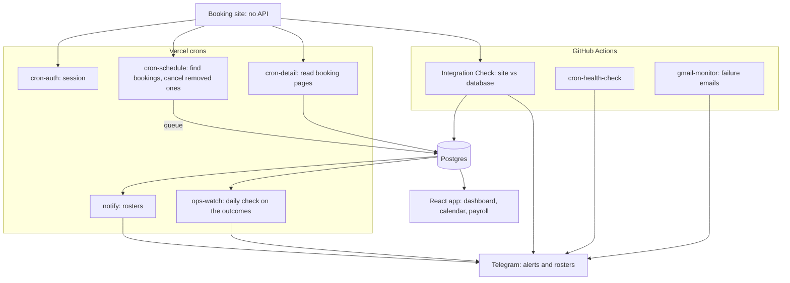

# Pawroll

A dog boarding operations platform: daily rosters and payroll for a small business, built by one engineer directing an AI coding agent (Claude Code) and run unattended on free-tier infrastructure.

The business books through a third-party site with no API, webhooks or export. This system reads that site every night, keeps its own database in step, sends the morning roster on schedule, and works out what each employee is owed per night. Most of the engineering is in making that reliable when the data source can change without notice, and in making sure a failure is never silent.

**Status (2026-10-31):** rosters and alerts run in production every day. The roster goes to the operator on Telegram, who forwards it to the client by hand. Payroll is not in use yet: user acceptance testing with the client is planned for November, and the rehearsal found payment bugs that are being fixed first (see [What broke](#what-broke-and-what-changed)).

| | As of 2026-10-31, on `main` |
|---|---|
| Tests | 2,687 passing, 1 skipped, in 103 files |
| Mutation score | 64.22% on the last full run (2026-10-26); 66.14% on the latest incremental run (2026-10-29). CI fails below 50% |
| Scheduled jobs | 13 Vercel crons, plus 7 GitHub Actions workflows on a schedule |
| Decisions and schema | 7 ADRs, 30 SQL migrations |
| Stack | React 19, Vite 7, Tailwind 4, Supabase (Postgres), Vercel, GitHub Actions, Playwright, Vitest, Stryker |

## How it works



- **Sync.** Nightly crons refresh the login session, read the schedule pages to queue bookings, and read each booking's page into Postgres. A booking gone from the site is confirmed by opening its own page, and only then cancelled ([ADR-010](docs/adr/010-removed-bookings-cancelled-nightly.md)).
- **The booking site is the source of truth.** Dogs, rates and bookings can't be edited in the app. A difference is a bug to fix at the source or in the sync.
- **Rosters.** Crons fire in every UTC hour a roster could fall in, and the code reads the Pacific clock to choose the window, so daylight saving needs no edits. Each window claims its day in one atomic database update, so a duplicate delivery sends once ([ADR-004](docs/adr/004-rosters-on-vercel-crons-with-claim-rows.md)). The roster image is rendered on the server with satori and resvg.
- **Pay.** A single function, `nightStays`, decides each night's dogs and money, and every screen calls it.
- **Dates.** The business is in San Francisco, so every date and time in the app is San Francisco time, whatever the device. One module reads booking times, and a guard test catches local-zone formatting in files that handle them ([ADR-009](docs/adr/009-booking-times-are-site-clock-times.md)).

## What broke, and what changed

Each of these changed how the system or the process works.

| What happened | How it was found | What changed |
|---|---|---|
| **Seven silent weeks.** GitHub disabled all 8 scheduled workflows after 60 days without a commit. Notifications stopped, and so did the health check, because it ran on the same scheduler. Later the sync crons kept reporting "success" while bookings stopped updating. | Not by any check: nothing alerted | The Ops rules below: alert on failure, check outcomes rather than runs, and watch from a different scheduler |
| **Wrong dog identity.** The server followed a redirect from a hidden booking to the week's schedule and read that page as the booking. That gave dogs another pet's ID, renamed one dog, and created empty dog rows. | Pet IDs that didn't match, traced through the logs and tables | Pages are read without following redirects; a redirected page writes nothing. A dog is its pet ID, enforced by a unique index, and the sync never renames one ([ADR-008](docs/adr/008-dog-identity-is-the-pet-id.md)) |
| **Two answers for the same night.** Eight copies of the nightly calculation had drifted apart: one night showed $338 on the Dashboard and $286 in Payroll. | A rehearsal of the acceptance test | One shared function, with expected values worked out by hand |
| **Times 7–8 hours off.** The site's times are Pacific clock times stored as if they were UTC, so a 10:15am pick-up showed as 3:15am. | The operator read the roster | Stored values kept, with one reader for all of them and a guard test ([ADR-009](docs/adr/009-booking-times-are-site-clock-times.md)) |
| **Removed bookings stayed on the roster and in pay.** Only a manual sync noticed them. | Bookings removed on the site were still in the app | Nightly check, with a report-only first night checked by hand before it went live ([ADR-010](docs/adr/010-removed-bookings-cancelled-nightly.md)) |
| **Open: payroll bugs.** Partial payments were averaged per night ($159.25 instead of $139.75), and a double-click recorded two payments 283 ms apart. | The second acceptance-test rehearsal | Being fixed before the client sees it, including a database guard against paying a night twice |

## How it's tested

Test counts don't show whether tests would catch a bug, so the measure here is mutation testing. [Stryker](https://stryker-mutator.io/) plants thousands of small bugs in the sync, notification and calculation logic, and counts how many make a test fail. CI runs it on `main` and fails below a threshold, currently 50%, that the process says is never lowered to make a PR pass. UI components are outside the score for now, so the 64% is for that logic only, and older code is still being brought up to the bar. New changes are run against their changed lines, and those results are in the [score log](docs/ENGINEERING_PROCESS.md#score-log).

The rules for tests ([full list](docs/ENGINEERING_PROCESS.md#good-tests-not-just-tests)):

- Expected values come from the requirement, worked out by hand, never pasted from the code's output.
- Every test is seen failing once.
- One rule per test, named as the rule, so a non-programmer can review the list.
- No snapshots. Only external boundaries are faked, using recorded response shapes.
- Booking-time logic is tested in time zones chosen to expose a wrong date (Kiritimati, Pago Pago), not only the developer's.

## How it's built

This is one person directing Claude Code, and nearly all of the code was written that way. An agent's confidence isn't evidence, so a persona prompt isn't the safeguard. The process copies what makes a team work instead: the reviewer didn't write the code, checks happen at fixed moments, and machines enforce the rules ([full process](docs/ENGINEERING_PROCESS.md)).

| Gate | When | How |
|---|---|---|
| Architect | Before a new job, service, secret or table | A half-page design note (options, what breaks, threat, how we'll know it's working), challenged by an agent with fresh context; the decision becomes an ADR |
| Reviewer | Before every PR | A fresh-context agent checks correctness against the requirements, then audits the tests, then ops and security |
| QA | Every push and PR | Required checks for lint, requirement coverage, tests and build; mutation score on `main`; a post-merge check that production changed |
| Security | Before secrets go live, and in review | Each secret's scope and leak impact are written down; CI rejects realistic phone numbers and emails in tests |
| Ops | Every scheduled run | Rules below |
| Human | Every rule the client sees | The operator decides those rules, runs all production SQL, and approves anything that sends a message |

The fresh-context review earns its place. On the Friday roster change, the reviewer found that a window comparison was matching timestamps as text (`+00:00` against `.000Z`), which would have dropped every booking exactly at the start hour.

### Ops rules: silence is never success

These are the rules for new jobs. Auditing the older jobs against them is still open, and some of those only show a red run.

1. **Failure is loud.** A failed job alerts on Telegram, and an alert that can't be delivered fails the run in turn.
2. **Check outcomes, not runs.** "The cron ran" isn't health. Data freshness, queue depth and delivered messages are.
3. **The watcher runs somewhere else.** A check on the same scheduler as its job dies with it, so ops-watch runs on Vercel and checks the last successful run of GitHub's main jobs.
4. **A new job ships with its alert** and its runbook entry, in the same PR.

## Known gaps

- Hosted on free tiers, where a cron can start late in its hour. GitHub's schedules can run hours late, which is why the rosters moved to Vercel.
- A sync redesign is under way to replace the overlapping nightly paths and cap requests to the booking site.
- The older ADRs and some docs in `docs/` are working records, not polished write-ups. ADR numbers 005–007 are reserved for decisions already shipped and still to be written up.

## Running it locally

```bash
git clone https://github.com/kcoffie/dog-boarding.git
cd dog-boarding
npm install
cp .env.example .env.local   # add your Supabase credentials
npm run dev                  # app only; API routes need `npx vercel dev`
npm run test:run             # the test suite
npm run mutate               # mutation testing (a full run takes about an hour on CI)
```

To set up a database, run `supabase/schema.sql`, then the migrations in `supabase/migrations/` in order.

## License

MIT
